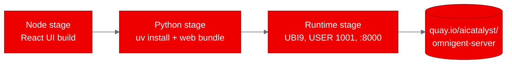
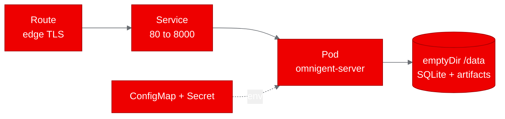

<!-- CHANGELOG — removed during finalization
v1 changes:
- Initial draft from PoC results (5/5 scenarios passed)
-->

## What is Omnigent?

Omnigent is an open-source "meta-harness" that puts a common orchestration
layer over the AI coding agents you already use. Instead of locking into one
tool, it lets you supervise Claude Code, Codex, Cursor, OpenCode, Hermes, Pi,
and agents you define yourself in YAML, all from the same session. It ships a
server that coordinates those sessions, enforces policies (approval gates,
spend caps, tool limits), and serves a web UI you can open from a laptop, a
browser, or a phone.

Think of it as the control plane for your agent fleet. The server is the
coordination point. The actual agent work runs on hosts that register with it,
so the server stays light and the heavy lifting happens wherever you point it.

## Why it matters for OpenShift AI

Most agent tooling is local first. It lives in a developer's terminal and
disappears when the laptop closes. Omnigent is different. It has a real server
deployment story, with a web UI, multi-user accounts, and policy governance,
which means it behaves like a platform workload rather than a throwaway demo.

That makes it a good fit for the agentic AI direction in Red Hat AI. Teams want
agents they can host, govern, and scale, not just run locally. Proving that an
orchestration layer like Omnigent deploys cleanly on OpenShift shows that rich
agent control planes can live alongside the model serving and customization
story, and talk to in-cluster inference endpoints through its LLM gateway.

## Setting up for deployment

We started from the upstream repository and analyzed its structure. It is a
monorepo with a Python server, a React web UI, a Python SDK, and a VS Code
editor. For the PoC we isolated the single deployable unit, the server, which
bundles the web UI into its image and listens on port 8000.

Two things stood out. The project already ships a UBI 9 Dockerfile and a full
set of Kustomize manifests, including OpenShift overlays with Routes and
security contexts. And the server can back itself with either Postgres or
SQLite. We chose SQLite so the PoC stays a single pod with no external
database, which is the easiest thing to prove on a cluster and the easiest
thing to reproduce.

## Containerizing for OpenShift

Because the project already provides `deploy/docker/Dockerfile.ubi`, we did not
have to write a base image from scratch. That file is a multi-stage build: a
Node stage compiles the React UI, a Python stage installs the server and its
dependencies with `uv`, and a final runtime stage assembles the two into a
non-root image that exposes port 8000 and runs a `/health` check.

We made two small changes to get a clean on-cluster build. First, we added a
root `.dockerignore` that trims the build context from roughly 124 megabytes to
about 54, dropping the test suites, docs, and deploy directories the image does
not use. Second, the project's Dockerfile defines a second target for the
sandbox host that installs `tmux`, a package that is not in the UBI 9
repositories in this environment. Since we only need the server, we built a
trimmed variant that contains just the stages the runtime depends on, which
skipped the host stage entirely.

The build ran as an OpenShift BuildConfig in a dedicated builds namespace and
pushed the result to Quay as `quay.io/aicatalyst/omnigent-server`.

## Deploying to the cluster

The deployment is deliberately small. A single Deployment runs the server, a
Service fronts it on port 80, and a Route exposes it over TLS. The server keeps
its SQLite database and artifact files on an `emptyDir` volume mounted at
`/data`, so the whole thing fits in one pod.

Getting the pod to start surfaced a real OpenShift detail. The namespace runs
the `restricted-v3` security context constraint, which rejects `fsGroup: 0` and
requires `hostUsers: false`. We set `fsGroup` to the start of the namespace's
assigned group range, set `hostUsers: false`, and added `runAsNonRoot: true` at
the container level. With that, the pod came up `1/1 Running` with zero
restarts, and the server logged that it had run its migrations and registered
its built-in agents.

## Running the PoC tests

We wrote a small Python test script using only the standard library and pointed
it at the Route. It exercised five pre-auth endpoints, which is enough to prove
the deployment is healthy without walking a full login flow:

- `GET /health` returned `{"status":"ok"}`, confirming the server and its
  database are up.
- `GET /api/version` returned the installed package version.
- `GET /v1/info` reported `accounts_enabled` and the server version, confirming
  the auth and feature subsystems wired up.
- `GET /` served the built web UI as HTML.
- `GET /login` served the login page.

All five scenarios passed on the first run.

## What we learned

The biggest lesson is that a well-packaged upstream project makes a PoC almost
trivial. Omnigent already spoke UBI and Kubernetes, so our job was mostly
verification, not invention. The two things that cost us time were both
environment quirks, not code problems: a fine-grained GitHub token that lacked
the `workflow` scope, which we sidestepped by trimming the fork's CI workflows,
and the `restricted-v3` constraint on `fsGroup`, which we solved by matching the
namespace's group range.

We also learned that choosing SQLite was the right call for a PoC. It kept the
deployment to one pod and removed an entire class of database connectivity
failures. For production you would want Postgres on a persistent volume, but for
proving the concept, less moving parts is better.

## Try it yourself

The fork lives at `aicatalyst-team/omnigent`, with the plan, test script, and
report on the `autopoc-artifacts` branch and the build and deployment files on
the `autopoc` branch. If you have a project you are curious about, feed its
repository URL to AutoPoC and it will walk the same path: analyze, containerize
on UBI, build, deploy, and test, then hand you a report and a blog post. The
hardest part is deciding what to try next.
