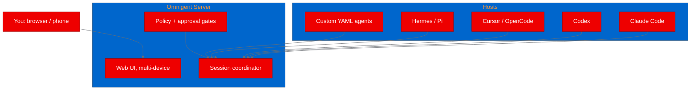
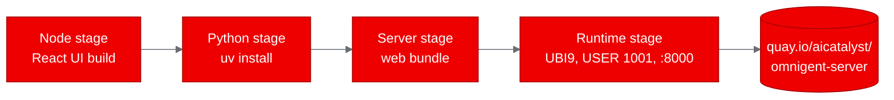
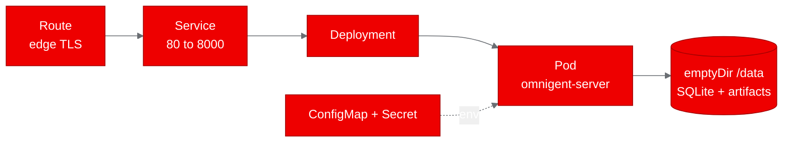

## What is Omnigent?

Most agent tooling dies when the laptop closes. It lives in a developer's
terminal, tied to a single machine and a single login, and it vanishes the
moment you step away. Omnigent attacks that gap. It is an open source
"meta-harness" that puts a common orchestration layer over the AI coding agents
you already use, and it ships a real server you can point a browser,
a mobile phone, or a whole team at.

Concretely, Omnigent lets you supervise Claude Code, Codex, Cursor, OpenCode,
Hermes, Pi, and agents you define yourself in extensible markup language (YAML),
all from the same session. Its server coordinates those sessions, enforces
policies such as approval gates and budget caps, and serves a web user interface
(UI). The server is the coordination point; the actual agent work runs on hosts
that register with it, so the server stays light and the heavy lifting happens
wherever you point it.



*Figure: The meta-harness model. You drive it from any device; agents run on
registering hosts; the server coordinates them behind a policy layer.*

## Why it matters for OpenShift AI

That server-first design is what makes it interesting on
[Red Hat OpenShift AI](https://www.redhat.com/en/products/openshift/openshift-ai).
Because Omnigent is a durable, multi-user, policy-governed service rather than a
throwaway demo, it behaves like a platform workload: something you host, scale,
and govern. That lines up with the agentic AI direction in Red Hat AI, where
teams want agents they can run as governed workloads, not just execute locally.

Proving that an orchestration layer of this kind deploys cleanly on OpenShift
shows that rich agent control planes can sit alongside the model serving and
customization story. The natural next step is pointing its large language model
(LLM) gateway at an in-cluster inference endpoint, which we left as a follow-on
proof rather than claiming it here. The sections that follow show exactly what
that deployment looks like and what it took to get there.

## Setting up for deployment

We started from the upstream repository and mapped its structure. It is a
monorepo with a Python server, a React web UI, a Python software development
kit (SDK), and a Visual Studio Code editor. For the proof of concept (PoC) we isolated the
single deployable unit, the server, which bundles the web UI into its image and
listens on port 8000.

2 things stood out. First, the project already ships a Red Hat Universal Base
Image (UBI) 9 Dockerfile and a full set of Kustomize manifests, including
OpenShift overlays with Routes and security contexts. Second, the server can
back itself with either Postgres or SQLite. We chose SQLite so the PoC stays a
single pod with no external database, which is the easiest thing to prove on a
cluster and the easiest thing to reproduce.

## Containerizing for OpenShift

Because the project already provides `deploy/docker/Dockerfile.ubi`, we didn't
have to invent a base image. That file is a multi-stage build that defines 6
stages. 4 of them feed the server image: a Node stage compiles the React UI, a
Python stage installs the server and its dependencies with `uv`, a server stage
folds in the web bundle, and a final runtime stage assembles a non-root image.
The other 2 stages, `node-runtime` and `host`, build a separate sandbox target
we didn't need. The runtime stage is the part that matters for OpenShift:

```dockerfile
FROM registry.access.redhat.com/ubi9/python-312 AS runtime
# ...copies the venv, the build, and the entrypoint...
EXPOSE 8000
USER 1001
HEALTHCHECK CMD curl -fsS "http://127.0.0.1:8000/health" || exit 1
CMD ["python", "/app/entrypoint.py"]
```

We made 2 small changes to get a clean on-cluster build. First, we added a root
`.dockerignore` that trims the build context from roughly 124 megabytes to about
54, dropping the test suites, docs, and deploy directories the image doesn't
use. Second, the file's `host` stage installs `tmux`, a package that is not in
the [UBI](https://www.redhat.com/en/technologies/cloud-computing/ubi) 9
repositories in this environment. Since we only need the server, we built a
trimmed variant, `deploy/docker/Dockerfile.ubi.autopoc`, that contains just the
runtime-relevant stages and skips `host` entirely.

We then built it on the cluster with a BuildConfig that points at that
Dockerfile and pushes to Red Hat Quay:

```bash
oc start-build omnigent-server \
  --from-dir=<repo-root> --follow --wait -n <builds-namespace>
# -> quay.io/aicatalyst/omnigent-server
```



*Figure: The 4 stages that feed the server image, ending in the Quay image.*

## Deploying to the cluster

The deployment is deliberately small. A single Deployment runs the server, a
Service fronts it on port 80, and a Route exposes it over Transport Layer
Security (TLS). The server keeps its SQLite database and artifact files on an
`emptyDir` volume mounted at `/data`, so the whole thing fits in 1 pod.

Getting the pod to start surfaced a real OpenShift detail. The namespace runs
the `restricted-v3` security context constraint, which rejects `fsGroup: 0` and
requires `hostUsers: false`. The security context that finally worked is shown
below:

```yaml
securityContext:
  fsGroup: 1001480000   # start of the namespace's assigned group range
  hostUsers: false
containers:
  - securityContext:
      runAsNonRoot: true
      allowPrivilegeEscalation: false
      capabilities:
        drop: [ALL]
      seccompProfile:
        type: RuntimeDefault
```

With that in place, `oc apply -f kubernetes/ -n poc-omnigent` brought the pod
up `1/1 Running` with 0 restarts, and the server logged that it had run its
migrations and registered its built-in agents.



*Figure: The single-pod topology: Route to Service to Deployment to Pod, with
an emptyDir volume and config injection.*

## Running the PoC tests

We wrote a small Python test script that uses only the standard library and
pointed it at the Route. It exercised 5 pre-auth endpoints, which is enough to prove the
deployment is healthy without walking a full login flow:

```bash
curl -s https://<route>/health        # => {"status":"ok"}
curl -s https://<route>/api/version   # => {"version":"0.19.0.dev0"}
curl -s https://<route>/v1/info       # => accounts_enabled=true, server_version set
curl -s https://<route>/ | head -1    # => <!doctype html>  (the web UI)
curl -s -o /dev/null -w '%{http_code}\n' https://<route>/login   # => 200
```

The health check confirms the server and its database are up, the version
endpoint confirms the package installed correctly, the info endpoint confirms
the auth and feature subsystems wired up, and the last 2 confirm the built web
UI and the login page are being served. All 5 scenarios passed on the first run.

## What we learned

The biggest lesson is that a well-packaged upstream project makes a PoC almost
trivial. Omnigent already spoke UBI and Kubernetes, so our job was mostly
verification, not invention. The 2 things that cost us time were both
environment quirks, not code problems. A fine-grained GitHub token lacked the
`workflow` scope, which we sidestepped by trimming the fork's continuous
integration (CI) workflows. And the `restricted-v3` constraint on `fsGroup`
took 1 iteration to match the namespace's group range.

We also learned that choosing SQLite was the right call for a PoC. It kept the
deployment to 1 pod and removed an entire class of database connectivity
failures. For production you'd want Postgres on a persistent volume, but for
proving the concept, fewer moving parts is better.

One caveat worth stating plainly: this PoC proves the control plane, the
coordination server and its web UI, not full agent execution. The harness work
runs on registered hosts, so a production rollout would also stand those hosts
up and point the LLM gateway at a real model.

## Try it yourself

Omnigent shows that a governable agent control plane can be a durable,
self-contained, UBI-packaged service on OpenShift, and it got there with almost
no custom work. The fork lives at
[aicatalyst-team/omnigent](https://github.com/aicatalyst-team/omnigent), with
the plan, test script, and report on the `autopoc-artifacts` branch and the
build and deployment files on the `autopoc` branch. If you have a project you're
curious about, feed its repository URL to AutoPoC and it will walk the same
path: analyze, containerize on UBI, build, deploy, and test, then hand you a
report and a blog post. The hardest part is deciding what to try next, so pick
one today and point AutoPoC at it.
