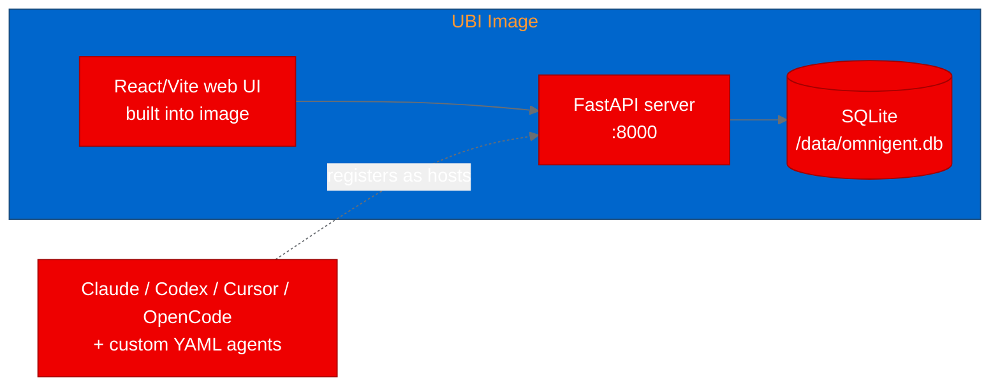
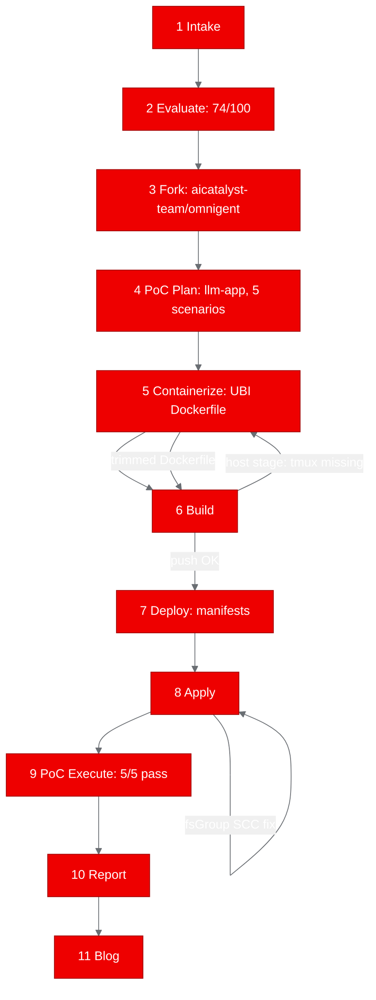
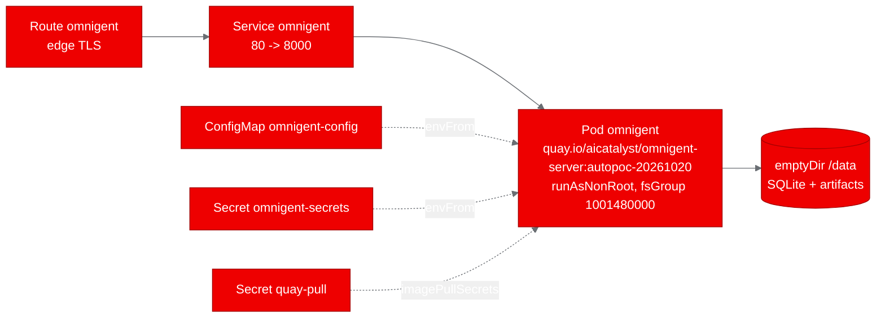

# PoC Report: Omnigent on OpenShift

**Project:** `omnigent` · **Source:** https://github.com/omnigent-ai/omnigent
**Fork:** https://github.com/aicatalyst-team/omnigent · **Date:** 2026-10-20
**Result:** ✅ SUCCESS — all 5 validation scenarios passed

---

## 1. Executive Summary

We evaluated **Omnigent**, an open-source "meta-harness" that provides a common
orchestration layer over many AI coding agents (Claude Code, Codex, Cursor,
OpenCode, Hermes, Pi, and custom YAML agents). The PoC objective was to prove
that Omnigent's **server** — the deployable control plane — containerizes on
UBI 9 and runs as a durable, non-root, self-contained pod on OpenShift. The PoC
**succeeded**: the UBI image was built on-cluster, deployed as a single pod with
an SQLite backing store on OpenShift, exposed through a Route, and all five
pre-auth control-plane checks (health, version, server-info, web UI, login page)
passed. The main friction points were a fine-grained GitHub token lacking the
`workflow` scope (worked around by trimming the fork's CI workflows) and an
unused Dockerfile stage pulling a package absent from UBI9 (fixed with a trimmed
build Dockerfile).

## 2. Project Analysis

**What it does:** Omnigent is a meta-harness / agent orchestration layer. The
deployable unit is a Python server (FastAPI + uvicorn) that coordinates
sessions, hosts, policies, and an LLM gateway, and serves a React web UI (built
into the image) on port 8000. It can run in "external-runner" mode where the
server is the coordination point and agent work runs on registered hosts.

| Component | Language | Build System | ML Workload | Port |
|---|---|---|---|---|
| omnigent-server | python | pip (uv) | No | 8000 |

- **Classification:** `llm-app` (agent orchestration control plane: FastAPI server + React web UI)
- **Technologies:** Python 3.12, FastAPI, uvicorn, SQLAlchemy (SQLite/Postgres), Alembic, React/Vite web UI, pnpm, UBI 9
- **Strategy fit:** Agentic AI (agent runtime, MCP, agents-API, developer experience) + Management/Observability/Security (policies, guardrails)

The repository is a monorepo (server, web UI, Python SDK, VS Code editor,
examples) but the PoC isolates the single deployable **server** component, which
bundles the web UI into its image.

## 3. PoC Objectives

1. Prove the Omnigent server containerizes on UBI 9 and deploys as a single,
   non-root, self-contained pod on OpenShift (no external database dependency).
2. Prove the server boots, initializes its backing store (SQLite on a volume),
   and serves its control-plane HTTP API reliably.
3. Prove the built web UI bundle is served and reachable through an OpenShift Route.
4. Demonstrate the OpenShift-native deployment pattern (Deployment + Service +
   Route + probes + security context) that the project's own Kustomize overlays target.

**Infrastructure identified:** medium resource profile (1Gi/2Gi, 500m/1 CPU),
no GPU, ephemeral `/data` volume (SQLite + artifacts), no sidecars, `accounts`
auth with a generated cookie secret.

## 4. Pipeline Execution

- **Intake:** Identified one deployable component (`omnigent-server`); the repo
  already ships a UBI 9 Dockerfile and Kustomize/OpenShift overlays.
- **Evaluate:** RHOAI fitness **74/100** (impact 14.8/20, feasibility 14.8/20);
  relationship *adjacent*; strategy areas Agentic AI + Management/Security.
- **Fork:** Force-synced the existing AutoPoC fork
  `aicatalyst-team/omnigent`; pushed the `autopoc` write branch. Upstream
  `.github/workflows` were trimmed to work around the fine-grained PAT lacking
  the `workflow` scope; branch protection returned 403 (token lacks
  Administration) — non-blocking.
- **PoC Plan:** Type `llm-app`; 5 HTTP scenarios; SQLite backing store; single
  `deployment` on port 8000; medium profile.
- **Containerize:** Reused `deploy/docker/Dockerfile.ubi`; added a root
  `.dockerignore` trimming the build context from ~124 MB to ~54 MB.
- **Build:** On-cluster BuildConfig (docker strategy, binary source). Build #1
  failed in the unused `host` stage (`dnf install tmux` not in UBI9); fixed with
  `deploy/docker/Dockerfile.ubi.autopoc` (runtime stages only). Build #2 pushed
  `quay.io/aicatalyst/omnigent-server:autopoc-20261020` (~590 MB).
- **Deploy:** Generated Namespace, ConfigMap, Secret, Deployment, Service, Route
  in `kubernetes/`; created a `quay-pull` image-pull secret in-cluster.
- **Apply:** First apply was rejected by the `restricted-v3` SCC
  (`fsGroup: 0` not allowed; `hostUsers` must be false); fixed with
  `fsGroup: 1001480000` (namespace GID-range start) + `hostUsers: false` +
  container `runAsNonRoot: true`. Pod reached `1/1 Running`, 0 restarts.
- **PoC Execute:** All 5 scenarios passed (exit 0).

## 5. Test Results

| Scenario | Status | Duration | Details |
|---|---|---|---|
| health-check | ✅ PASS | 0.05s | `GET /health` → `{"status":"ok"}` |
| version-info | ✅ PASS | 0.02s | `GET /api/version` → `{"version":"0.19.0.dev0"}` |
| server-info | ✅ PASS | 0.02s | `GET /v1/info` → `accounts_enabled=true`, `server_version=0.19.0.dev0` |
| web-ui | ✅ PASS | 0.02s | `GET /` → HTML SPA (title "Omnigent", bundled assets) |
| login-page | ✅ PASS | 0.02s | `GET /login` → HTML login page |

**Summary: 5 / 5 passed.** No failures, no container-level issues.

## 6. Infrastructure Deployed

- **Namespace:** `poc-omnigent`
- **Image:** `quay.io/aicatalyst/omnigent-server:autopoc-20261020` (~590 MB, UBI 9)
- **Resources:**
  - `Deployment/omnigent` — 1 replica; requests 1Gi/500m, limits 2Gi/1 CPU
  - `Service/omnigent` — ClusterIP 80 → 8000
  - `Route/omnigent` — edge TLS
  - `ConfigMap/omnigent-config`, `Secret/omnigent-secrets`, `Secret/quay-pull`
- **Route URL:** `https://omnigent-poc-omnigent.apps.ocp-gb.ibm.redhataicatalyst.com`
- **Storage:** `emptyDir` at `/data` (SQLite DB + artifacts). Ephemeral by
  design for the PoC; the DB re-initializes on pod start via migrations.

## 7. Recommendations

- **Production readiness:** Strong. The project ships a production-grade UBI
  image and Kustomize overlays; our PoC validated the OpenShift path. For
  production, switch the backing store from SQLite/emptyDir to **Postgres on a
  PVC** (the project's `openshift-postgres` overlay) for durability and
  multi-replica support.
- **Persistence:** The PoC used an `emptyDir` to avoid block-PVC ownership
  issues under the restricted SCC. For durable data, use a PVC with
  `fsGroup` set to the namespace GID-range start (as done here) or an
  initContainer to fix ownership.
- **Security:** Runs non-root (random UID, group from the namespace range),
  `runAsNonRoot: true`, `allowPrivilegeEscalation: false`, all capabilities
  dropped, `RuntimeDefault` seccomp — compliant with the `restricted-v3` SCC.
  Keep the cookie secret and (for Postgres) DB credentials in a Secret, not a
  ConfigMap.
- **Scalability:** The server is horizontally scalable for the control plane;
  agent execution is delegated to registered hosts, so scaling the server pod
  scales coordination, not agent compute. A multi-replica setup would need a
  shared Postgres and sticky/leader-elected scheduling for the scheduler.
- **Next steps:** (1) Point a host at the server (`omnigent host <url>`) and run
  a real agent session end-to-end; (2) try the `openshift-postgres` overlay for
  a durable, multi-user deployment; (3) evaluate OIDC (`OMNIGENT_OIDC_*`) for
  enterprise SSO.

## 8. Open Data Hub / OpenShift AI Considerations

- Omnigent is an **agentic-orchestration** workload, not a model-serving one, so
  it does not map onto KServe/ModelMesh directly. It complements the Red Hat AI
  **Agentic AI** story (Llama Stack / MCP) by demonstrating that a rich,
  governable agent control plane runs as a standard OpenShift workload.
- Its LLM gateway can point at any OpenAI-/Anthropic-compatible endpoint,
  including an in-cluster inference service or the Red Hat AI Inference Server,
  so it can be wired to ODH-hosted models.
- For ODH integration, the natural home is a plain OpenShift project (as here);
  no ODH-specific CRDs are required. If teams want model access, pair it with
  an ODH model serving deployment and set the gateway base URL accordingly.
- Governance features (policies, spend caps, approval gates) align with the
  Management/Observability/Security strategy area and could be surfaced alongside
  TrustyAI-style guardrails.

## 9. Appendix

**Artifacts (in fork `aicatalyst-team/omnigent`):**
- PoC plan: `poc-plan.md` (branch `autopoc-artifacts`)
- Test script: `poc_test.py` (branch `autopoc-artifacts`)
- Build Dockerfile: `deploy/docker/Dockerfile.ubi.autopoc` (branch `autopoc`)
- Context trim: `.dockerignore` (branch `autopoc`)
- Manifests: `kubernetes/{namespace,configmap,secret,deployment,service,route}.yaml` (branch `autopoc`)
- Image: `quay.io/aicatalyst/omnigent-server:autopoc-20261020`
- Live URL: `https://omnigent-poc-omnigent.apps.ocp-gb.ibm.redhataicatalyst.com`

**Errors encountered & resolutions:**
1. **Fork push rejected** — fine-grained PAT lacked `workflow` scope for a branch
   containing `.github/workflows`. Resolved by trimming the workflows from the
   `autopoc` write branch.
2. **Branch protection 403** — PAT lacked Administration scope. Non-blocking
   (we push to `autopoc`/`autopoc-artifacts`, not the protected `main`).
3. **Build #1 failed** — `host` stage `dnf install tmux` not found in UBI9.
   Resolved with a trimmed build Dockerfile (runtime stages only).
4. **Apply rejected by SCC** — `fsGroup: 0` disallowed by `restricted-v3`;
   `hostUsers` must be false. Resolved with `fsGroup: 1001480000` +
   `hostUsers: false` + container `runAsNonRoot: true`.

**Retries:** build_retries = 1 (Dockerfile trim); deploy SCC fix applied once.
